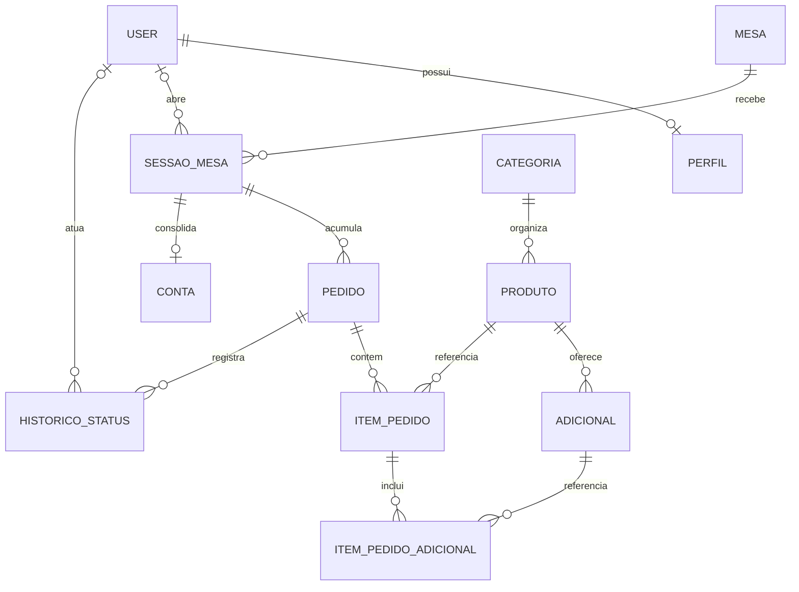
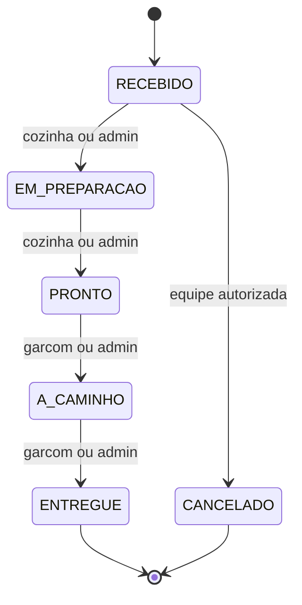
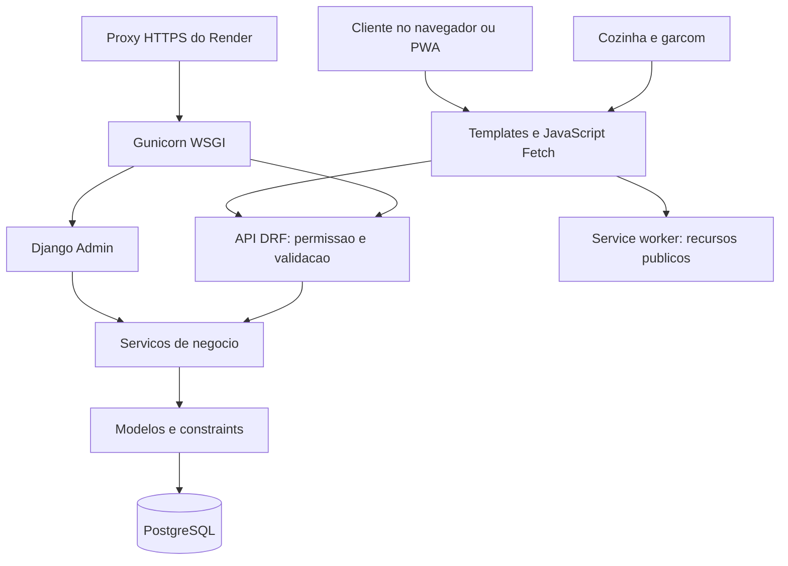

# MesaFácil — auditoria de requisitos, domínio e decisões técnicas

**Data:** 28/10/2026. **Aplicação:** <https://mesafacil-co9h.onrender.com/>.
**Código revisado:** `6ce926f24d1199c842df3054f75d803867bab62c`, branch `main`.
**Natureza:** avaliação de produto e engenharia; sem alteração das funcionalidades ou do banco publicado.

## 1. Parecer executivo

O MesaFácil implementa o núcleo do MVP planejado: um restaurante recebe pedidos
por QR Code, coordena cozinha e atendimento e encerra uma conta com pagamento
simulado. O projeto já tem jornada de negócio, telas operacionais, controles de
acesso, integridade financeira e uma publicação HTTPS funcional. A arquitetura
escolhida é proporcional ao problema e à capacidade de uma dupla mantê-la.

**O aceite completo ainda deve ser condicionado a correções e evidências.**
Nesta revisão houve **90 testes aprovados, 1 falha e 5 testes ignorados**, em
SQLite. A falha é uma regressão confirmada: o commit `6ce926f` esvaziou
`AUTH_PASSWORD_VALIDATORS`, retirando a validação que antes recusava senhas
fracas. Também foi reproduzido HTTP 500 ao excluir pela API uma mesa com
histórico. O banco preserva os registros, mas a resposta da aplicação é incorreta.

A publicação foi verificada por consultas HTTP e Chrome. Cardápio, fotos de
amostra, recursos estáticos, manifesto, service worker e navegação offline
funcionaram; o acesso anônimo às áreas operacionais foi bloqueado. Isso não
comprova, por si só, a execução autenticada de todo o atendimento no Render.

| Dimensão | Parecer |
| --- | --- |
| Escopo funcional do MVP | Implementado em grande parte; existe uma lacuna confirmada no tratamento de exclusão de mesas |
| Domínio e integridade | Modelagem consistente; serviços, transações, estados e preços históricos cobrem as regras centrais |
| Segurança | CSRF, perfis e isolamento estão implementados; a regressão dos validadores de senha precisa ser corrigida |
| PWA | Recursos públicos, offline e critérios de instalação passaram no Chrome; falta registrar instalação em aparelho físico |
| Publicação de testes | Ativa e útil para ensaio; limitada pela expiração do banco e pelo armazenamento temporário |
| Aceite acadêmico | Condicionado à suíte sem falhas, revalidação PostgreSQL e demonstração em dois aparelhos |
| Operação comercial contínua | Ainda requer trabalho de persistência, recuperação, monitoramento e capacidade; não é o objetivo comprovado deste deploy |

Não é necessário trocar Django, adotar microserviços ou reescrever a interface
para resolver as lacunas encontradas. O próximo investimento deve ser fechar o
aceite e estabilizar a operação existente.

## 2. Base de requisitos e limites da auditoria

### De onde vieram os critérios

Foram confrontados os [prompts iniciais](prompts/01-planejamento.md), os registros
dos [modelos e escopo consolidado](prompts/05-marco2-base-cardapio.md), as
[regras críticas](prompts/06-marco3-pedidos-e-testes.md), o
[esboço das telas](esboco-telas.md), a
[matriz de 23/10](AVALIACAO_E_PLANO_2026-10-23.md), o
[aceite registrado](ACEITE_FINAL.md), o [histórico de execução](EXECUCAO.md),
o código atual, a suíte e a aplicação publicada.

Os registros antigos contêm propostas depois substituídas, como estados
`PENDENTE`/`EM_PREPARO` e CRUD genérico de pedidos. A referência utilizada para
aceite foi a consolidação posterior: RF01–RF25, RNF01–RNF13 e RN01–RN10.
Não foi localizado nesta varredura um documento original independente do
enunciado do professor. Assim, este parecer verifica os requisitos preservados
no repositório; não substitui conferência de um enunciado externo divergente.

### O que foi efetivamente feito nesta revisão

- Leitura de modelos, migrations, serviços, views, serializers, permissões,
  admin, sinais, configurações, templates, JavaScript, PWA, scripts e documentos.
- Execução da suíte atual, checks Django, verificação de migrations, geração
  estrita de OpenAPI e verificação das dependências instaladas.
- Três sondagens adicionais em banco temporário para reproduzir exclusão de
  mesa, crescimento de consultas e reaparecimento de produto demonstrativo.
- **27 consultas GET públicas** ao deploy, sem login nem escrita de negócio.
- Chrome **156.0.8078.48**, páginas inicial/login em três larguras, teste de
  service worker, cache, navegação offline e reconexão. A inspeção visual também
  considerou capturas da página inicial móvel e do login desktop.
- Verificação de instalabilidade com perfil persistente temporário. O primeiro
  contexto anônimo reportou `in-incognito`; a repetição em perfil normal ficou
  sem erros de manifesto ou instalabilidade. O primeiro resultado não foi
  interpretado como defeito do app.

### Limites que afetam a conclusão

O runtime local é Python **3.11.5 / Django 5.2.17**; o deploy informado nos logs
usa Python **3.13.18 / Django 6.1.2**. Os testes locais não certificam essa
combinação de destino. Não foram usados credenciais, pedidos reais, alterações
de disponibilidade, pagamentos ou consultas ao banco de produção.

Os cinco testes concorrentes exigem PostgreSQL e foram ignorados no ambiente
rápido. O documento anterior registra 87 testes PostgreSQL e ensaios de navegador,
mas esses resultados são **históricos**, não execuções repetidas nesta auditoria.

O commit local foi identificado. O último log de deploy fornecido antes da
publicação citava `ec9fb2a`; o site não expõe uma identificação inequívoca de
versão. Portanto, não se afirma que cada achado local já está no processo
publicado. Em particular, a retirada dos validadores foi comprovada no código
`6ce926f`, sem testar senhas no site.

As [evidências resumidas](evidencias/AUDITORIA_2026-10-28.json) acompanham este
relatório. Logs, sondagens e capturas brutos ficam em `.tmp/`, ignorado pelo Git.

## 3. Produto: problema, atores e jornada

O problema atendido é coordenar o atendimento de uma mesa, desde a escolha do
cliente até a liberação para o próximo grupo, reduzindo a necessidade de
transmitir manualmente cada pedido entre salão e cozinha. A redução de espera
é uma hipótese de valor; não houve medição com restaurante real para quantificá-la.

| Ator | Trabalho que o produto permite realizar | Limite de responsabilidade |
| --- | --- | --- |
| Cliente | Identificar a mesa pelo QR, montar/revisar pedidos, acompanhar e solicitar a conta | Não administra a mesa nem aprova pagamento |
| Cozinha | Ler fila por estado, iniciar preparo, marcar pronto e alterar disponibilidade | Não confirma entrega nem encerra contas |
| Garçom | Abrir atendimento, retirar/entregar pedidos, conferir e finalizar a conta | Não administra todo o catálogo ou as permissões da equipe |
| Administrador | Cadastrar catálogo, mesas e equipe, consultar histórico e operar os painéis | O admin também deve respeitar as regras transacionais |

A jornada está coerente com o planejamento: o garçom abre a sessão; o cliente
envia um pedido revisado; a cozinha prepara; o garçom entrega; novos pedidos podem
ser enviados na mesma sessão; a conta soma o consumo não cancelado; o pagamento
simulado encerra a sessão e libera a mesa.

O pagamento aqui registra uma aprovação operacional de teste. Selecionar Pix,
cartão ou dinheiro **não movimenta dinheiro, verifica Pix ou consulta uma
adquirente**. Isso atende à decisão expressa de simulação do MVP.

O produto foi delimitado a um restaurante. Gateway real, multiempresa, nota
fiscal, impressão de comandas, estoque, divisão de conta, pedidos lançados pelo
garçom, setores e relatórios avançados ficaram fora do MVP consolidado. Sua
ausência não foi classificada como descumprimento dos requisitos obrigatórios.

## 4. Domínio: o significado das entidades

O domínio é **atendimento de restaurante organizado por mesa e sessão**. A
distinção mais importante é entre mesa física e atendimento: a mesma mesa recebe
grupos diferentes ao longo do dia, e cada grupo deve ter consumo separado.

| Entidade | Significado no negócio | Decisão estrutural |
| --- | --- | --- |
| `Mesa` | Local físico que pode ser habilitado ou desabilitado | Número único e UUID estável para o QR |
| `SessaoMesa` | Um atendimento daquela mesa | Separa pedidos antigos dos novos e admite apenas uma sessão ativa por mesa |
| `Categoria`, `Produto`, `Adicional` | Oferta atual do restaurante | Catálogo pode mudar sem recalcular preços de pedidos já enviados |
| `Pedido` | Uma intenção confirmada de consumo | Vários pedidos podem compor a mesma sessão; cada um tem seu estado |
| `ItemPedido` | Produto, quantidade e instrução efetivamente pedidos | Copia o preço unitário vigente no envio |
| `ItemPedidoAdicional` | Extra efetivamente selecionado para um item | Copia o preço do adicional, em vez de depender de um M2M sem valor histórico |
| `HistoricoStatusPedido` | Registro das etapas e de seus autores | Evento inicial e alterações acompanham a transação do pedido |
| `Conta` | Consolidação e aprovação simulada do fechamento | No máximo uma conta por sessão; registra meio, valor e momento do pagamento |
| `User` e `Perfil` | Identidade da equipe e responsabilidade operacional | Login Django e papéis ADMIN/COZINHA/GARCOM; cliente não precisa de conta |



As cardinalidades representam vínculos persistidos. O serviço exige ao menos
um item na criação de um pedido e grava seu evento inicial; a relação de banco,
sozinha, não exige quantidade mínima de linhas filhas.

### Sessão, pedido e conta não são sinônimos

`Mesa.ativa` significa que a mesa está disponível no cadastro, e não que está
ocupada. Livre, ocupada e aguardando conta são estados derivados da sessão ativa
e de `conta_solicitada`. Essa escolha reduz a possibilidade de manter dois campos
de ocupação contraditórios, embora o cálculo atual gere consultas repetidas.

A sessão é a fronteira de consistência do atendimento: abrir, pedir, solicitar
conta, pagar e fechar precisam concordar sobre qual atendimento está vigente.
Ela pode ser entendida como raiz lógica dessa operação, sem afirmar que o
projeto implementa todo um conjunto formal de padrões DDD.

O pedido é uma remessa à cozinha. A conta agrega as remessas daquela sessão.
Pedir a conta sinaliza atendimento; não equivale a pagar e não bloqueia, por
si só, novos pedidos. O fechamento exige ausência de pedidos pendentes.



O cancelamento é permitido somente em `RECEBIDO`. Uma sessão com pedidos em
`RECEBIDO`, `EM_PREPARACAO`, `PRONTO` ou `A_CAMINHO` não pode ser paga/encerrada.
Sessão vazia ou sem valor cobrável pode ser fechada sem pagamento, desde que não
tenha pendências. A conta exclui cancelados da cobrança, preservando-os na consulta.

### Exemplo financeiro

`(R$ 32,90 + R$ 5,00 + R$ 4,00) × 2 = R$ 83,80`.

O servidor calcula com `Decimal`, usando preços copiados do catálogo no momento
do pedido. Alterar depois o hambúrguer para R$ 39,90 não muda o consumo anterior.
O navegador calcula uma prévia e envia `total_esperado`; o servidor compara com
seu cálculo para pedir nova confirmação em caso de reajuste.

O snapshot atual preserva **preços**, não o texto de todo o catálogo. Renomear
produto ou adicional muda o nome exibido nas consultas históricas, pois os nomes
continuam vindo das entidades referenciadas. Isso não viola o requisito de
preservação de preços, mas limita uma futura necessidade de comprovante imutável.

## 5. Arquitetura e organização do código

Trata-se de um monólito Django com um app de domínio, páginas renderizadas no
servidor e interações por API REST. A separação interna existe por responsabilidade;
não são microsserviços nem aplicações independentes de cliente/cozinha/garçom.



O diagrama destaca as operações críticas. Há CRUD de catálogo e consultas que
usam diretamente ORM/serializers, sem passar pelos serviços; não se trata de uma
regra absoluta de que toda view chama um serviço.

| Local | Responsabilidade efetiva |
| --- | --- |
| [`core/settings.py`](../core/settings.py), [`core/urls.py`](../core/urls.py) | Banco, autenticação, cookies, arquivos, HTTPS e entrada das rotas |
| [`models.py`](../restaurante/models.py) e [`migrations/`](../restaurante/migrations/) | Entidades, relacionamentos, estados, cálculo e restrições persistentes |
| [`services/__init__.py`](../restaurante/services/__init__.py) | Abrir, criar pedido, transitar, solicitar conta, pagar e fechar com regras/transações |
| [`views.py`](../restaurante/views.py), [`serializers.py`](../restaurante/serializers.py) | Contratos HTTP, validação de entrada, representação e consultas |
| [`permissions.py`](../restaurante/permissions.py), [`security.py`](../restaurante/security.py) | Papéis, contexto de mesa/sessão e CSRF também para anônimos |
| [`admin.py`](../restaurante/admin.py), [`signals.py`](../restaurante/signals.py) | Gestão interna, ações protegidas e sincronização de perfil/permissões |
| [`templates/`](../templates/), [`static/js/`](../static/js/) | Experiência do usuário, polling, revisão, rascunho e recuperação de envio |
| [`pwa.py`](../restaurante/pwa.py), [`service-worker.js`](../templates/service-worker.js) | Manifesto, página offline e política seletiva de cache |
| [`management/commands/`](../restaurante/management/commands/) | Provisionamento, demonstração e pré-checagens |
| [`scripts/`](../scripts/), [`render.yaml`](../render.yaml) | Validação, scripts de publicação e configuração declarativa disponível |

### Como a integridade é construída

Primeiro, serializers recusam entradas inválidas. Depois, os serviços conferem
as regras no estado atual e executam as alterações dentro de transações. Por fim,
constraints protegem invariantes como sessão ativa única, chave de envio única
por sessão e valores não negativos.

`transaction.atomic` mantém consistência entre alterações relacionadas;
`select_for_update` evita que operações concorrentes decidam a partir do mesmo
estado desatualizado. O código procura bloquear mesa, sessão e depois pedido,
mantendo uma ordem consistente. Produtos/adicionais também são bloqueados na
criação. Esses bloqueios podem gerar espera e seu custo ainda precisa de medição
sob carga. SQLite não reproduz os bloqueios de linha do PostgreSQL, razão pela
qual os cinco testes concorrentes são separados.
[Transações Django](https://docs.djangoproject.com/en/6.1/topics/db/transactions/),
[select_for_update](https://docs.djangoproject.com/en/6.1/ref/models/querysets/#select-for-update).

As transições e o histórico são gravados juntos. O histórico é auditoria de
estados, não uma arquitetura de event sourcing nem um registro completo de todas
as alterações do catálogo, usuários e pagamentos externos.

### Como o cliente evita duplicar um envio

O carrinho é um rascunho no navegador. Só vira pedido após confirmação no servidor.
A tentativa leva uma `chave_envio`; o serviço usa chave, sessão e hash do conteúdo
para retornar o pedido original em uma repetição e rejeitar conteúdo diferente.
O frontend guarda o rascunho e a tentativa em `sessionStorage` para recuperar uma
resposta perdida. Isso não é fila de pedidos offline nem garantia de entrega.

`chave_envio` e `total_esperado` são opcionais na API, embora o frontend do projeto
os envie. Um consumidor externo que omita a chave não recebe a mesma proteção
contra duplicidade. `sessao_id` também aparece como opcional no serializer, mas
é semanticamente exigido para criar em uma sessão aberta. O contrato pode ser
mais explícito antes de abrir integração com terceiros.

## 6. Decisões técnicas: motivos e consequências

Os motivos abaixo combinam decisões explícitas do plano com a avaliação técnica
desta revisão. Quando o plano não registrou uma justificativa formal, a razão
apresentada é uma interpretação profissional da escolha, não uma declaração
atribuída retrospectivamente aos autores.

| Decisão observada | Adequação ao problema | Consequência ou limite |
| --- | --- | --- |
| Monólito Django e app `restaurante` | Mantém negócio, autenticação e deploy sob uma mesma base, adequada ao MVP | Separações futuras devem surgir por necessidade; serviços/views já concentram responsabilidades suficientes para exigir organização cuidadosa |
| PostgreSQL como banco da aplicação | Relações, transações, unicidade condicional e concorrência são centrais para atendimento | PostgreSQL deve participar da validação; SQLite serve apenas ao retorno rápido |
| Serviços compartilhados entre API e ações do admin | Impede que uma segunda interface contorne fechamento e estados | Novas entradas de escrita precisam respeitar essa fronteira; uso direto do ORM ainda pode ignorar regras de serviço |
| Transações, locks e constraints em conjunto | Protegem concorrência e falhas parciais em operações de consumo | Bloqueios não provam capacidade de carga; a ordem e duração das transações precisam ser mantidas |
| Decimal e cópia de preços no item | Evita cobrar valores de catálogo posteriores ao envio | Nome/descrição não são snapshots completos; totais são recalculados a partir dos itens preservados |
| Sessões Django, papéis e CSRF em mesma origem | Compatíveis com templates/Fetch e sem necessidade de JWT para esse fluxo | Perfil, permissões Django e provisionamento precisam permanecer sincronizados |
| UUID da mesa mais contexto da sessão | Evita enumeração simples e pedidos atrasados no atendimento seguinte | Quem conhece o link pode abrir seu contexto; QR não comprova presença física nem identifica cada pessoa da mesa |
| Templates, Bootstrap local e JavaScript sem framework de aplicação | Reduz build e coordena páginas operacionais com poucos componentes | JavaScript manipula estado/DOM manualmente; complexidade de carrinho e recuperação precisa continuar testada |
| Polling em torno de quatro segundos | Atende atualização sem recarregar, sem adicionar Redis/Channels | Há atraso e custo recorrente; intervalo é agendado após a consulta, não uma garantia rígida de atualização em 4 s |
| Django Admin para gestão, telas próprias para operação | Evita construir uma área administrativa inteira no MVP | Admin exige treinamento; campos de estado devem continuar protegidos |
| PWA com cache apenas público e sem fila de escritas | Evita que uma ação financeira ou de consumo seja reenviada silenciosamente | Sem rede, o cliente consulta informação salva; não opera atendimento offline |
| Gunicorn WSGI e WhiteNoise | Suficientes para HTTP/Fetch; estáticos com hash e cache longo | Não há necessidade demonstrada de ASGI/WebSocket; uploads são outra responsabilidade |
| Render Free e PostgreSQL Free | Permitem URL HTTPS e ensaio compartilhado com baixo custo inicial | Hibernação, banco com validade e disco temporário limitam continuidade |
| Provisionamento no start | Contorna ausência de shell/pre-deploy no serviço Free | Todo restart executa migrações e seed; adequado ao teste, mas precisa de controle para uso real |
| Versões diretas fixadas | Reduz variação nas dependências explicitamente escolhidas | Não há lock completo das transitivas; o ambiente local atual não corresponde às versões do deploy |

Não existe hoje uma entidade `Restaurante` ou um `restaurante_id` nos registros.
Número de mesa e nome de categoria têm unicidade global. Isso é coerente com
restaurante único e mostra que multiempresa seria uma mudança de domínio e
autorização, não apenas acrescentar um filtro à interface.

## 7. Matriz de atendimento dos requisitos

**Implementado** significa código e evidência indicados, sem estender essa prova
a todas as combinações de dispositivo/ambiente. **Parcial** indica uma lacuna ou
aceite incompleto identificado. Os números antigos não foram tratados como
certificação automática do código atual.

### Requisitos funcionais

| ID | Critério consolidado | Parecer | Evidência e limite |
| --- | --- | --- | --- |
| RF01 | Entrada por QR e identificação da mesa | Implementado | UUID, página `cliente`, `mesa_por_uuid`; leitura física do QR publicado ainda deve ser registrada |
| RF02 | Gestão/geração do QR | Implementado | Ações e links no admin, PNG autenticado e geração por demanda; anônimo recebeu 403 no deploy |
| RF03 | Abrir e encerrar sessão | Implementado | Serviços `abrir`, `fechar`, `pagar`; cenários em `test_waiter.py` e `tests.py` |
| RF04 | Mapa livre/ocupada/aguardando conta | Implementado | `mapa_mesas`, `MesaSerializer`, `garcom.js`; possui dívida de consultas descrita adiante |
| RF05 | Cardápio com categoria, foto, descrição e preço | Implementado com limite de mídia | API publicada: 6 categorias e 15 produtos com foto informada; duas fotos acessadas com 200; uploads próprios não têm persistência no Free |
| RF06 | Quantidade, adicionais e observações | Implementado | Modal/serializers/serviço; quantidade 1–99 e observação por item até 255 caracteres |
| RF07 | Bloquear produtos indisponíveis | Implementado | Interface consulta mudanças; serviço revalida e reverte pedido inválido |
| RF08 | Carrinho editável e remoção | Implementado | `cliente.js`, sessão do navegador e scripts de regressão anteriores |
| RF09 | Totais corretos | Implementado | `Decimal`, snapshots e testes de R$ 83,80; preços do cliente não comandam o cálculo |
| RF10 | Revisar e confirmar envio | Implementado | Modal, comparação do total esperado e revalidação no envio |
| RF11 | Vários pedidos na mesma sessão | Implementado | Relação sessão/pedidos e testes de chaves distintas/repetição |
| RF12 | Cliente acompanha pedidos | Implementado | Consulta por contexto de mesa/sessão e polling |
| RF13 | Cozinha organizada por estados | Implementado | Três colunas, dados dos itens e ordenação por antiguidade |
| RF14 | Iniciar preparo e marcar pronto | Implementado | Máquina de estados no modelo e autorização no serviço |
| RF15 | Cozinha controla disponibilidade | Implementado | Endpoint protegido e controles em `cozinha.js` |
| RF16 | Atualização automática da cozinha | Implementado | `MF.poll` e testes anteriores de interface; não é push instantâneo |
| RF17 | Garçom recebe prontos e confirma entrega | Implementado | Painel com `PRONTO`/`A_CAMINHO` e transições específicas |
| RF18 | Solicitações de conta ao garçom | Implementado | Sinalização e lista por sessão ativa com conta solicitada |
| RF19 | Conta acumulada | Implementado | Pedidos da sessão, cancelados visíveis e excluídos do valor devido |
| RF20 | Cliente/equipe solicitam conta | Implementado | Endpoints distintos usam `pedir_conta`; não encerram atendimento imediatamente |
| RF21 | Meio de pagamento simulado | Implementado | PIX/CARTAO/DINHEIRO no atendimento; sem gateway real, conforme escopo |
| RF22 | Aprovação libera a mesa | Implementado | Pagamento e encerramento na mesma transação; repetição recusada |
| RF23 | Gestão de mesas e catálogo | **Parcial** | CRUD e proteções existem, mas DELETE de mesa com sessão retorna 500 em teste isolado |
| RF24 | Cadastro da equipe e papéis | Implementado | UserAdmin/Perfil/sinais e regressão contra promoção a superusuário; senha fraca é ressalva em RNF07 |
| RF25 | Consultas administrativas | Implementado | Admin e APIs por data/status; contas pagas; filtros inválidos cobertos por testes |

### Requisitos não funcionais

| ID | Critério consolidado | Parecer | Evidência e limite |
| --- | --- | --- | --- |
| RNF01 | PWA instalável | **Parcial no aceite** | Manifesto, ícones e critérios Chrome passaram; instalação física ainda sem evidência desta revisão |
| RNF02 | Página offline e informação salva | Implementado | Chrome publicado abriu fallback e cardápio salvo, reconectou e não apresentou erros JS |
| RNF03 | Responsividade | **Parcial na revalidação** | Inicial/login sem overflow em 390/768/1366; telas operacionais têm testes históricos, não foram reensaiadas com login no Render |
| RNF04 | Atualização sem recarga | Implementado | Polling em cliente/cozinha/garçom com tratamento de falhas e páginas ocultas |
| RNF05 | UUID e proteção do QR | Implementado | UUID aleatório, listagem de mesas restrita, PNG 403 e caminho antigo público 404 no deploy |
| RNF06 | Permissões e isolamento | Implementado com limite de validação | Papéis/contexto, testes de mesa diferente e sessão antiga; APIs publicadas bloquearam anônimos; fluxo autenticado remoto não ensaiado |
| RNF07 | Credenciais e segurança de acesso | **Parcial** | Hash, CSRF e cookies seguros permanecem; validadores de senha vazios no commit atual, com teste falhando |
| RNF08 | Preços históricos preservados | Implementado | Cópia de preço de produto/adicional e testes após reajuste |
| RNF09 | REST/Fetch e documentação | Implementado com ressalva de contrato | OpenAPI estrito local aprovado; 31 caminhos/47 operações publicados; semântica dos campos opcionais merece explicitação |
| RNF10 | Testes das regras críticas | **Parcial** | Há cobertura relevante, mas suíte atual não está verde; cinco corridas PostgreSQL não foram repetidas |
| RNF11 | Ambiente por variáveis e segredos fora do Git | Implementado | `.env` ignorado, exemplo sem credenciais reais, `DATABASE_URL` e detecção do domínio Render |
| RNF12 | Execução/documentação reproduzíveis | **Parcial** | Scripts/build funcionaram; histórico de aceite e política de senha divergem do código atual, e runtime local difere do alvo |
| RNF13 | pt-BR, BRL e São Paulo | Implementado | Idioma/fuso Django e formatação explícita no JavaScript |

### Regras de negócio

| ID | Regra | Parecer | Evidência e limite |
| --- | --- | --- | --- |
| RN01 | Sequência obrigatória de estados | Implementada | Matriz independente de 36 combinações e serviço `transitar` |
| RN02 | Cancelamento só antes do preparo | Implementada | Transição terminal disponível apenas a partir de RECEBIDO |
| RN03 | Histórico das transições | Implementada | Evento inicial, autoria e rollback em falha; não equivale a auditoria de todo o sistema |
| RN04 | Pedidos apenas em atendimento válido | Implementada | Mesa ativa, sessão aberta, contexto e sessão esperada revalidados |
| RN05 | Uma sessão ativa por mesa | Implementada | Constraint condicional e bloqueio da mesa; corrida real pendente de repetição nesta revisão |
| RN06 | Fórmula por item | Implementada | `(preço unitário + adicionais) × quantidade` no servidor |
| RN07 | Caso financeiro de referência | Implementada | R$ 41,90 por unidade e R$ 83,80 para duas, verificados na suíte |
| RN08 | Indisponível invalida o pedido | Implementada | Serviço rejeita e transação reverte criação parcial |
| RN09 | Sem fechar com pedidos pendentes | Implementada | Validação comum a pagamento/fechamento e admin protegido |
| RN10 | Sessão encerrada não aceita pedido antigo | Implementada | `ativa`, contexto e `sessao_id`; teste de reabertura e prevenção de reativação |

## 8. Verificações do site publicado

As consultas ocorreram em 28/10/2026; a coleta HTTP registrou
`2026-10-28T23:14:57Z`. Foram verificações pontuais, sem teste de carga ou garantia
de disponibilidade futura.

| Área | Resultado observado |
| --- | --- |
| `/`, `/entrar/` | HTTP 200; páginas renderizadas e recursos carregados no Chrome |
| `/admin/`, `/painel/`, `/cozinha/`, `/garcom/` | HTTP 302 para login, sem conteúdo operacional exposto |
| APIs de mesas, sessões, cozinha, garçom, consultas admin e usuário | HTTP 403 anônimo |
| `/api/mesas/1/qr-code/` | HTTP 403 anônimo |
| `/media/qrcodes/mesa_1_qrcode.png` | HTTP 404; o caminho previsível antigo não entrega QR |
| `/api/cardapio/` | HTTP 200; 6 categorias, 15 produtos, 15 com campo de foto preenchido |
| Duas fotos de exemplo e três ícones | HTTP 200; os ícones usam hash e cache público imutável |
| Manifesto/service worker/offline | HTTP 200 com tipos adequados; escopo do SW `/` |
| PWA no Chrome | Manifesto sem erros; instalação elegível em perfil persistente; SW ativo; offline e reconexão funcionais |
| Cache inspecionado | Recursos públicos e cardápio; nenhum caminho privado encontrado no percurso testado |
| Responsividade pública | Inicial/login sem overflow horizontal nas três larguras testadas |
| Cabeçalhos e cookies observáveis | CSRF com `Secure` e `SameSite=Lax`; rotas privadas com `no-store`; `DENY`, `nosniff` e política de referenciador presentes |
| URL inexistente | 404 genérico, sem traceback ou lista detalhada de rotas |
| `/api/schema/`, `/api/docs/` | HTTP 200; schema com 31 caminhos e 47 operações |

Não foi produzido cookie autenticado de equipe; logo, os atributos desse cookie
não foram inspecionados no ambiente remoto. O cookie CSRF ser legível por script
é compatível com o envio pelo frontend e não foi classificado como falha.

Os conjuntos de caminhos do schema versionado, gerado localmente e publicado
coincidem. Os schemas não são integralmente idênticos: a comparação local/remoto
encontrou 27 diferenças de metadados de inteiros (`format`, `maximum`, `minimum`).
A diferença de runtime/banco é uma explicação plausível, não uma causa isolada
comprovada. Para evidência definitiva, gere e valide o contrato no runtime alvo.

## 9. Achados e recomendações priorizadas

### A1 — Validadores de senha removidos: prioridade alta

**Evidência:** [`core/settings.py`](../core/settings.py) define
`AUTH_PASSWORD_VALIDATORS = []`. O diff `ec9fb2a..6ce926f` retira os quatro
validadores anteriores. O teste
`RenderBootstrapTests.test_missing_or_weak_initial_password_stops_without_creating_data`
falha porque uma senha fraca deixa de produzir `CommandError`.

**Impacto:** a chamada a `validate_password` continua no provisionamento, mas não
há política configurada para ela aplicar. Não é uma correção de segurança; é
remoção de uma defesa. Hash de senha e validação de força são controles distintos.
A constatação não prova que a senha usada no Render seja fraca nem recupera sua
senha. [Validação de senhas Django](https://docs.djangoproject.com/en/6.1/topics/auth/passwords/#password-validation).

**Decisão recomendada:** restaurar os validadores e usar credencial forte no
ambiente. Manter o teste como critério de saída, sem enfraquecê-lo para aceitar
a regressão. Restaurar validação não exige migração nem altera automaticamente
senhas já cadastradas. Também é necessário conferir qual commit está Live.

### A2 — Exclusão de mesa com histórico retorna 500: prioridade média, antes do aceite

**Reprodução isolada:** criar uma mesa, associar uma sessão e executar DELETE
autenticado em `/api/mesas/<id>/`. Resultado observado: **500**, com a mesa
preservada. O FK `PROTECT` funciona; falta converter `ProtectedError` em erro de
negócio. `CatalogoViewSet` já faz esse tratamento, `MesaViewSet` não.

**Decisão recomendada:** devolver 400 ou 409 com explicação para preservar o
histórico e orientar a desativação quando permitida. Acrescentar regressão que
verifique a resposta e a preservação dos vínculos. Não remover a proteção do banco.

### A3 — Mapa do garçom com consultas proporcionais às mesas: prioridade média

**Medição isolada:** 3 mesas geraram **8 consultas**; 10 mesas geraram **22**.
`status_display` e `sessao_ativa_id` consultam a sessão ativa separadamente.
O `prefetch_related('sessoes')` existente não elimina as chamadas filtradas.

**Impacto:** uma rodada com 10 mesas ainda é pequena, mas o polling repete esse
trabalho. Isso é um problema demonstrado de crescimento de consultas, não uma
prova de lentidão percebida ou saturação em produção.

**Decisão recomendada:** carregar a sessão ativa uma vez por mesa com prefetch
filtrado/atributo ou anotações e reaproveitar o resultado. Medir a quantidade de
consultas e o tempo antes/depois. A cozinha já tem teste de consultas estáveis.

### A4 — Seed demonstrativo incondicional no start: prioridade média para evolução

`preparar_render` chama `seed_data` em todo início. A sonda apagou um produto de
exemplo sem histórico e repetiu o seed: **o produto reapareceu**. Alterar o nome
de um exemplo também pode levar à criação de outro registro com o nome esperado.

Preservar preços existentes com `get_or_create` é útil, mas não significa
preservar a intenção administrativa de remover/renomear dados. Para o ambiente
demonstrativo, o comportamento pode ser aceito e documentado. Para operação real,
separe migração obrigatória, restauração de imagens demonstrativas e carga de
catálogo, com opção explícita para executar o seed.

### A5 — Persistência do ambiente gratuito: limite operacional conhecido

O PostgreSQL Free expira em 30 dias, e o disco do Web Service é temporário.
As imagens demonstrativas são recriadas; fotos próprias enviadas pelo admin não
têm essa garantia. O banco guarda o caminho do arquivo, não seu conteúdo.
O serviço também pode hibernar após inatividade.
[Limites oficiais](https://render.com/docs/free).

Para a apresentação, registre a data de expiração e ensaie o primeiro acesso.
Para continuidade, escolha retenção/backup e armazenamento persistente de mídia.
Não se conclui que o banco atual já esteja prestes a expirar: sua data de criação
não foi consultada no painel.

### A6 — Revalidação e automação de qualidade: prioridade alta para fechar o aceite

Existe cobertura relevante, mas a suíte atual falha e não há pipeline de CI
versionado encontrado em `.github/`. A aprovação de build do Render não executa
a suíte de negócio. Repetir testes no runtime Python 3.13/Django 6.1.2 e em
PostgreSQL dedicado, incluindo as cinco corridas, antes de declarar aceite final.
Não utilizar o banco publicado de demonstração como banco destrutivo de testes.

O acompanhamento de saúde configurado no Blueprint usa `/`, que renderiza a
entrada e não verifica banco. Assim, esse check isolado não prova disponibilidade
do atendimento. Um endpoint de prontidão com consulta mínima é uma melhoria
operacional, não uma funcionalidade exigida no MVP original.

### A7 — Documentação e publicação precisam distinguir intenção de estado real

`ACEITE_FINAL.md` e `EXECUCAO.md` contêm evidências válidas de momentos anteriores;
não devem ser interpretadas como suíte atual sem falhas. `RENDER.md` descreve
principalmente Blueprint e integração GitHub; nesta conversa o serviço foi
criado manualmente por URL pública. O `autoDeployTrigger` do YAML não configura
retroativamente esse serviço.

Pela documentação do Render, publicação por URL pública exige deploy manual;
auto-deploy requer provedor Git conectado. A configuração efetiva de região,
plano, banco, variáveis e atualização pertence ao serviço existente no painel,
que não foi acessado nesta auditoria.
[Regras de deploy](https://render.com/docs/deploys).

### A8 — Melhorias de segurança para exposição continuada

Não foram encontrados controles de tentativas de login/rate limiting no código
inspecionado. HSTS e CSP não apareceram nas respostas coletadas. São melhorias
de defesa e operação, sem exploração demonstrada e sem classificá-las como
funcionalidades ausentes do enunciado. Devem seguir a correção comprovada de senha,
os testes e o aceite do fluxo, com política compatível com HTTPS e a interface.

## 10. Qualidade: o que os testes demonstram

| Verificação desta auditoria | Resultado | Interpretação |
| --- | --- | --- |
| `python -m pytest -q` | 90 passaram, 1 falhou, 5 ignorados | Suíte atual não pode ser declarada aprovada |
| Cinco testes de concorrência | Ignorados em SQLite | Não há nova prova de locks PostgreSQL nesta execução |
| `manage.py check --settings=core.test_settings` | Sem problemas | Configuração rápida consistente; não prova tudo no ambiente remoto |
| `makemigrations --check --dry-run` na configuração rápida | Sem mudanças | Modelos e migrations atuais estão alinhados nessa checagem |
| OpenAPI com `--validate --fail-on-warn` | Aprovado localmente | Geração técnica sem erros/avisos; não garante semântica completa do contrato |
| `pip check` | Sem dependências quebradas | Vale para os pacotes instalados localmente, não confirma igualdade com `requirements.txt` |
| Três sondagens adicionais | Comportamentos reproduzidos | Confirmação dos achados A2/A3/A4, não correção dos defeitos |
| Chrome publicado | Percurso público aprovado | Sem JS errors, offline e reconexão funcionais; não inclui operação autenticada |

A suíte cobre casos importantes: matriz de estados, rollback de auditoria,
sessão fechada/antiga, adicionais indevidos, produto indisponível, snapshots,
pagamentos nos três meios e cancelados sem cobrança. Quantidade de testes não é
cobertura de linhas, teste de carga ou comprovação de todos os requisitos visuais.

Para reproduzir o retorno rápido, em ambiente com dependências compatíveis:

```powershell
python -m pytest -q
python manage.py check --settings=core.test_settings
python manage.py makemigrations --check --dry-run --settings=core.test_settings
python manage.py spectacular --settings=core.test_settings --file .tmp/openapi-auditoria.yaml --validate --fail-on-warn
```

Para integração, em **PostgreSQL exclusivo de testes**, com permissão de criação
de banco e dependências do runtime alvo, o projeto oferece
`python -m pytest --ds=core.settings -q`. Confira a configuração antes de executar;
os testes criam e removem um banco de teste. Não são necessárias mudanças no banco
publicado para reproduzir os achados locais.

## 11. Ordem recomendada de trabalho e critérios de saída

| Ordem | Entrega | Critério verificável |
| --- | --- | --- |
| 1 | Restaurar a política de senha e conferir a versão Live | Teste que hoje falha passa; credenciais de implantação permanecem fora do Git |
| 2 | Tratar exclusão protegida de mesa | Erro de negócio, sem 500 e sem perda de histórico |
| 3 | Executar suíte no runtime alvo e PostgreSQL dedicado | Todos os testes aprovados, incluindo as cinco corridas; contrato validado no mesmo ambiente |
| 4 | Ensaiar o deploy com contas de cozinha/garçom e dois aparelhos | QR publicado → pedido de R$ 83,80 → preparo → entrega → conta → pagamento → mesa livre |
| 5 | Registrar PWA e isolamento após reabertura | Instalação física, offline sem envio e pedido antigo recusado; nenhum atendimento de teste deixado aberto |
| 6 | Atualizar a documentação de operação e a evidência de aceite | Commit/URL/data/runtime, modo de deploy, limites de mídia e validade do banco identificados |
| 7 | Reduzir consultas e controlar o seed no start | Mapa sem crescimento de consultas por mesa e catálogo administrativo preservado conforme modo escolhido |
| 8 | Preparar continuidade se o teste virar operação | Retenção, restauração, mídia persistente, logs/alertas e capacidade ensaiados |

O ensaio deve usar usuários próprios de teste e sessões separadas de navegador.
A pré-checagem `verificar_demonstracao --celular` ajuda a verificar configuração
e dados, mas não substitui o percurso físico. A existência dos perfis de cozinha
e garçom no banco publicado ainda precisa ser confirmada pelo administrador:
o provisionamento Render cria o primeiro admin, não toda a equipe.

## 12. Síntese para explicar o projeto

Uma apresentação técnica fiel pode ser conduzida assim:

> O MesaFácil organiza o atendimento de um restaurante por mesa. O QR identifica
> o local, e a sessão separa cada grupo de consumo. Cada confirmação gera um
> pedido com itens e preços preservados. Cozinha e garçom avançam uma sequência
> controlada, e a conta só é encerrada quando não há pedidos pendentes. Django
> concentra interface, API e administração; PostgreSQL sustenta as relações e as
> garantias transacionais; o navegador consulta atualizações por polling. O PWA
> permite consultar informação salva sem prometer envio offline. O pagamento é
> simulado. O deploy gratuito permite ensaio, mas a conclusão de aceite depende
> de corrigir as regressões e registrar o fluxo completo no ambiente publicado.

As decisões estruturais mais fortes são a separação mesa/sessão, o preço
histórico por item e os serviços de operação compartilhados. As próximas decisões
devem consolidar essas garantias, em vez de ampliar o escopo antes do aceite.
